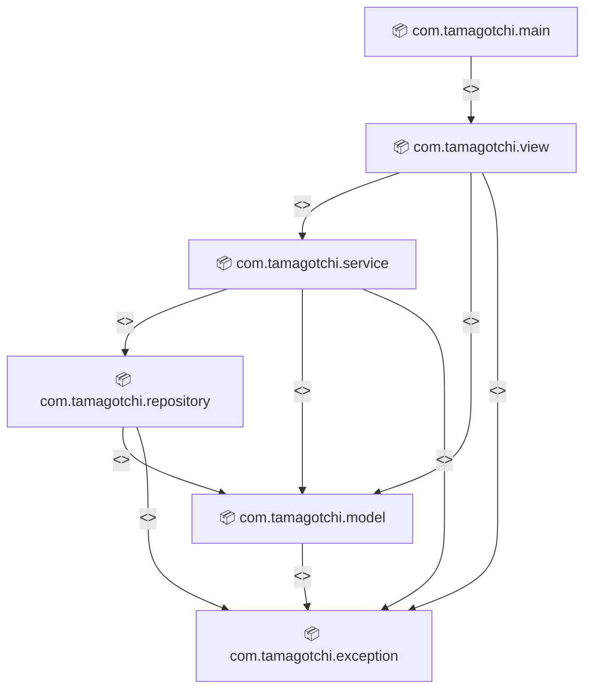

# 🐾 PET Project — Tamagotchi Orientado a Objetos 
## 👥 Equipe
* **Maria de Lourdes** - 2610559 - Função: Código fonte
* **Talita Maia** - 2220208 - Documento de casos de uso
* **Juliana Correia** -  - Diagrama de classes

## 📌 Visão Geral
O **Tamagotchi OO** é um bichinho virtual criado no Japão em 1996. Você adota uma criatura digital e cuida dela em tempo real. Ela nasce, cresce e tem necessidades e pode morrer se negligenciada. O objeto é mantê-lo vivo e feliz.
Com base nisso, vem as Funcialidades Principais, as features.
- **Gestão vital:** Controle de fome, energia e felicidade.
- **Ações:** Alimentar, comer, brincar e dormir.
- **Inventário:** Gerenciamento de itens via 'List'.
- **Tratamento de Erros:** Exceções customizadas para ações inválidas (Alimentar pet dormindo).
- 
## Funcionalidades
- **Menu inicial:** iniciar o jogo ou fechar.
- **Criação do bichinho:** o jogador escolhe o nome e a espécie (Gato, Cachorro ou Coelho).
- **Status do bichinho:** exibe Fome (saciado), Energia, Felicidade e Higiene, cada uma de 0 a 100.
- **Alimentar:** aumenta a saciedade e gasta um pouco de energia.
- **Controle dos valores:** as necessidades nunca passam de 100 nem ficam abaixo de 0.
- **Tratamento de exceção:** exceção personalizada (`PetNaoEncontradoException`) quando se tenta agir sem ter um pet.
- **Arquitetura em camadas:** pacotes `model`, `view`, `service`, `repository` e `exceptions`.
- **POO aplicada:** classe abstrata `Necessidade` com subclasses (`Saciado`, `Energia`, `Felicidade`, `Higiene`), com herança, polimorfismo (`passarTurno()`), encapsulamento e composição.

## 🏗️ Driagrama de Pacotes

